# Dokumentasi Teknis — Platform Pendaftaran Schematics NIC

Dokumen ini menjelaskan seluruh aplikasi: arsitektur, isi tiap folder dan file, fungsi-fungsinya, model data (ERD), keamanan, sampai alur aplikasi tiap peran. Isinya ditulis berdasarkan kode di branch `mahda` setelah commit `1d78bcf` ("feat(backend): integrate crypto services into data endpoints"). Kebutuhan produk ada di [`README.md`](./README.md) (PRD).

> **Status implementasi saat ini**
> - **Backend** (FastAPI): semua endpoint di kontrak API sudah ada. 5 dari 6 test kontrak lulus (`pytest`) — satu test (`test_existing_database_migrates_without_data_loss`) gagal karena masih memakai skema plaintext lama, lihat [14.1](#141-isu-yang-ditemukan).
> - **Penyimpanan sudah terenkripsi.** Sejak commit `1d78bcf`, `MIGRATIONS` di `database.py` diarahkan ke `app/db/migrations/` (skema kripto) dan `app/db/items.py`/`app/db/users.py` memanggil `crypto_services` untuk setiap tulis/baca. Skema plaintext lama (`migrations_before_crypto/`) masih ada di repo sebagai arsip, tidak lagi dijalankan. Rincian lengkap di [Bagian 6](#6-modul-kriptografi-crypto_services).
> - **Frontend** (React): halaman peserta (dashboard, profil, dokumen, tim, video) dan halaman auth/consent sudah jadi. Halaman juri, superadmin, benchmark, dan *Encryption Inspector* masih berupa placeholder — belum menampilkan apa pun soal enkripsi yang kini sudah aktif di backend.
>
> Rinciannya ada di [Bagian 14](#14-status-batasan-dan-catatan).

## Daftar isi

1. [Gambaran umum](#1-gambaran-umum)
2. [Arsitektur](#2-arsitektur)
3. [Struktur folder](#3-struktur-folder)
4. [Konfigurasi](#4-konfigurasi)
5. [Backend: modul dan fungsi](#5-backend-modul-dan-fungsi)
6. [Modul kriptografi (`crypto_services`)](#6-modul-kriptografi-crypto_services)
7. [Frontend: modul dan fungsi](#7-frontend-modul-dan-fungsi)
8. [Model data dan ERD](#8-model-data-dan-erd)
9. [Keamanan dan hak akses](#9-keamanan-dan-hak-akses)
10. [Alur aplikasi](#10-alur-aplikasi)
11. [Daftar endpoint](#11-daftar-endpoint)
12. [Format error dan kode status](#12-format-error-dan-kode-status)
13. [Menjalankan dan menguji](#13-menjalankan-dan-menguji)
14. [Status, batasan, dan catatan](#14-status-batasan-dan-catatan)

---

## 1. Gambaran umum

Schematics NIC adalah platform pendaftaran hackathon khusus mahasiswa. Peserta mendaftar, mengisi data diri, mengunggah KTP/KTM/twibbon, membentuk tim, lalu ketua tim mengunggah proposal, video demo, dan link GitHub. Superadmin memverifikasi peserta dan menugaskan juri. Juri membuka karya tim yang sudah final.

### 1.1 Peran

| Peran | Cara akun dibuat | Yang bisa dilakukan |
| --- | --- | --- |
| `peserta` | Mendaftar sendiri (`POST /api/auth/register`) | Menyetujui kebijakan privasi, mengisi data diri, mengunggah dokumen, membuat/bergabung tim. Ketua tim juga mengunggah karya, submit final, dan mengeluarkan anggota. Bisa melihat log akses, mengekspor data, dan menarik persetujuan |
| `juri` | Dibuat superadmin (`POST /api/admin/juri`), wajib ganti password saat login pertama | Melihat tim **final yang ditugaskan kepadanya**, membuka proposal, video, dan link repo tim itu |
| `superadmin` | Dibuat otomatis saat startup dari `SUPERADMIN_EMAIL`/`SUPERADMIN_PASSWORD` di `.env` | Melihat dan memverifikasi peserta, membuka semua item, membuat akun juri dan menugaskannya ke tim, mengatur tenggat/ukuran tim/kebijakan privasi, membaca audit log dan ringkasan benchmark |

### 1.2 Tech stack

| Bagian | Teknologi |
| --- | --- |
| Backend | Python, FastAPI 0.115 + Uvicorn |
| Database | SQLite (mode WAL) lewat modul `sqlite3` bawaan Python, tanpa ORM |
| Sesi | JWT (PyJWT, HS256) di cookie HttpOnly + token CSRF double-submit |
| Password | Argon2id (`argon2-cffi`) |
| Validasi | Pydantic v2, `pydantic-settings` untuk `.env` |
| Rate limit | `slowapi` (per IP) |
| Kriptografi | PyCryptodome (AES, DES, ARC4, GCM, HKDF) + `hmac`/`hashlib` bawaan |
| Frontend | React 19 + TypeScript + Vite 8 |
| Routing & state | React Router 7, TanStack Query 5 (data server), Zustand 5 (state sesi & UI) |
| Styling | Tailwind CSS 4, `lucide-react` (ikon), `three` (latar halaman login) |
| Mock API | MSW (Mock Service Worker) 3 |
| Test | `pytest` + `httpx` (backend), Vitest + Testing Library (frontend), Playwright (E2E) |

---

## 2. Arsitektur

### 2.1 Gambaran sistem

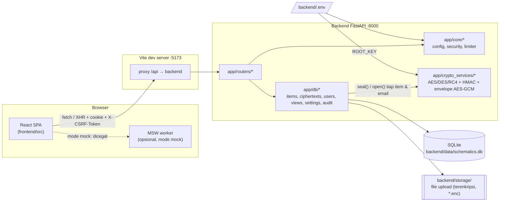

- Frontend dan backend berdiri sendiri (dependency dan cara jalan terpisah).
- Saat pengembangan, Vite mem-proxy `/api/*` ke FastAPI, sehingga browser melihat satu origin. Cookie sesi (`SameSite=Lax`) jadi bekerja tanpa pengaturan CORS.
- Dengan `VITE_ENABLE_MSW=true`, request `/api/*` dicegat MSW di browser dan dijawab mock berstatus (stateful) dari `frontend/src/mocks/handlers.ts`, jadi frontend bisa jalan tanpa backend.

### 2.2 Lapisan backend

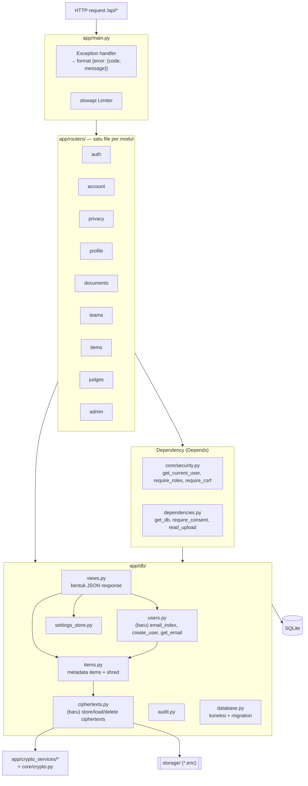

| Lapisan | File | Tanggung jawab |
| --- | --- | --- |
| Aplikasi | `app/main.py` | Membuat objek `FastAPI`, menjalankan migration dan seed superadmin saat startup, memasang exception handler, mendaftarkan semua router dengan prefix `/api` |
| Router | `app/routers/*.py` | Validasi body (Pydantic), aturan bisnis (tenggat, ketua tim, status tim), hak akses per item, susun response |
| Dependency | `app/core/security.py`, `app/dependencies.py` | Dipasang lewat `Depends(...)`: identitas user dari JWT, cek role, cek CSRF, cek consent, satu koneksi DB per request, baca body upload |
| Lapisan data | `app/db/*.py` | Semua akses tabel `items` (metadata), `ciphertexts` (isi terenkripsi), `settings`, `audit_logs`, serta tulis/hapus file terenkripsi di `storage/`. `views.py` menyusun objek JSON yang dipakai banyak router |
| Kripto | `app/crypto_services/`, `app/core/crypto.py`, `app/db/ciphertexts.py`, `app/db/users.py` | Enkripsi tiga cipher + pembungkusan kunci. **Aktif** — setiap tulis/baca item dan email lewat jalur ini |
| Penyimpanan | `data/schematics.db`, `storage/` | Data terstruktur dan teks di SQLite; file upload di folder |

### 2.3 Siklus satu request

Contoh `PUT /api/profile` (peserta mengubah data diri):

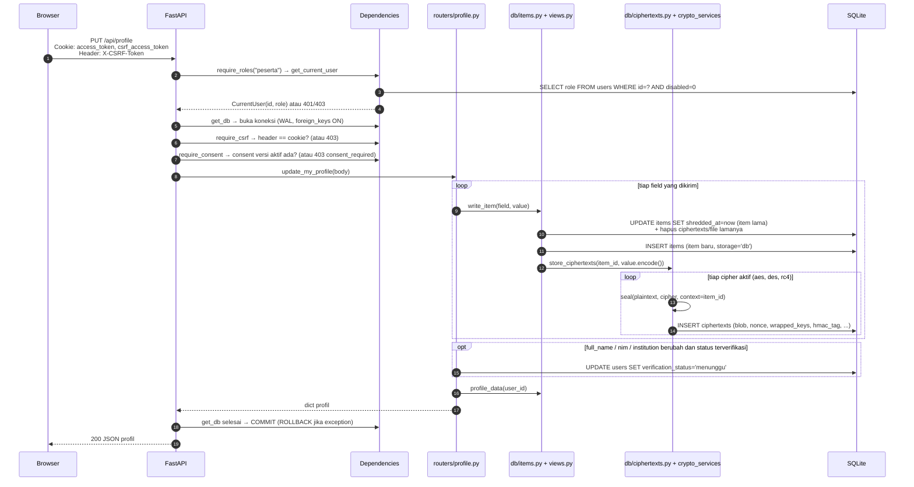

Hal penting:
- **Satu request = satu transaksi.** `get_db` commit di akhir kalau tidak ada exception dan rollback kalau ada.
- **Urutan dependency mengikuti urutan parameter.** `current_user` ditulis pertama, jadi request tanpa sesi dijawab 401 sebelum CSRF-nya dicek.
- **`get_current_user` membuka koneksi sendiri** untuk mengecek user masih ada dan `disabled = 0`. Akibatnya JWT milik akun yang sudah menarik persetujuan langsung ditolak walau belum kedaluwarsa.
- **Startup** (`lifespan` di `main.py`): `migrate_db` → buat folder `storage/` → `_seed_superadmin`.

### 2.4 Lapisan frontend

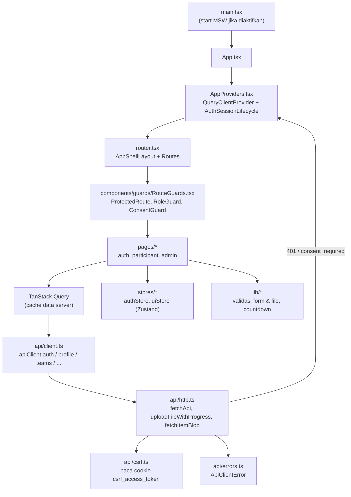

---

## 3. Struktur folder

### 3.1 Root repo

```
KI_Cryptography1/
├── README.md            # PRD: kebutuhan produk, desain kripto, benchmark, pembagian kerja
├── ARCHITECTURE.md      # dokumen ini
├── .gitignore           # satu .gitignore untuk backend + frontend
├── backend/             # API FastAPI (Python)
└── frontend/            # SPA React (TypeScript)
```

### 3.2 Backend

```
backend/
├── run.py                       # entry point: python run.py → uvicorn app.main:app
├── requirements.txt             # dependency runtime
├── requirements-dev.txt         # + pytest, httpx
├── .env.example                 # contoh konfigurasi (salin ke .env)
├── .env                         # konfigurasi lokal (gitignored)
├── README.md                    # ringkasan backend
├── API.md                       # referensi endpoint versi lama (lihat catatan Bagian 14)
├── data/                        # file SQLite (gitignored, dibuat otomatis)
├── storage/                     # file upload (gitignored, dibuat otomatis)
├── tests/
│   └── test_api_contract.py     # test kontrak API + alur end-to-end di backend
└── app/
    ├── main.py                  # app FastAPI, lifespan, exception handler, daftar router
    ├── dependencies.py          # get_db, require_consent, read_upload
    ├── core/
    │   ├── config.py            # Settings dari .env
    │   ├── security.py          # JWT cookie, CSRF, require_roles, Argon2id
    │   ├── limiter.py           # instance slowapi Limiter
    │   └── crypto.py            # get_crypto_service(): .env → CryptoService (dipakai sejak 1d78bcf)
    ├── crypto_services/         # modul kripto murni (tanpa FastAPI/SQLite)
    │   ├── __init__.py          # ekspor publik modul
    │   ├── base.py              # kontrak CipherSuite & EncryptedPayload
    │   ├── aes256_ctr_hmac.py   # AES-256-CTR + HMAC-SHA256
    │   ├── des_ctr_hmac.py      # DES-CTR + HMAC-SHA256
    │   ├── rc4.py               # RC4 tanpa nonce dan tanpa HMAC
    │   ├── _mac.py              # compute_tag / verify_tag HMAC
    │   ├── registry.py          # nama cipher → CipherSuite
    │   ├── keyring.py           # HKDF: ROOT_KEY → KEK & kunci blind index
    │   ├── envelope.py          # kunci data acak per ciphertext, dibungkus AES-256-GCM
    │   ├── service.py           # CryptoService: seal(), open(), email_index()
    │   └── errors.py            # CryptoError, IntegrityError, KeyConfigError, UnknownCipherError
    ├── db/
    │   ├── database.py          # connect_db, migrate_db, konstanta MIGRATIONS (kini → migrations/)
    │   ├── items.py             # baca/tulis tabel items (metadata) + ciphertexts (isi) lewat crypto_services
    │   ├── ciphertexts.py       # (baru) simpan/baca tabel ciphertexts: store_ciphertexts, load_plaintext, delete_ciphertexts
    │   ├── users.py             # (baru) akun: create_user, email_taken, email_index, get_email (email tersimpan sbg item terenkripsi)
    │   ├── views.py             # penyusun JSON: profil, dokumen, tim, /me, settings publik
    │   ├── settings_store.py    # tabel settings (tenggat, ukuran tim, kebijakan privasi)
    │   ├── audit.py             # tulis audit_logs
    │   ├── migrations_before_crypto/   # skema plaintext — ARSIP, tidak lagi dijalankan
    │   │   ├── 001_initial.sql
    │   │   └── 002_api_contract.sql
    │   └── migrations/                 # skema kripto — YANG AKTIF
    │       ├── 001_initial.sql         # users.email_index, items (metadata saja), ciphertexts, dst.
    │       └── 002_api_contract.sql    # (baru) users.disabled, items.parent_item_id + index unik anak
    └── routers/
        ├── auth.py              # /api/auth/*
        ├── account.py           # /api/me, /api/settings, /api/me/items, /access-log, /export
        ├── privacy.py           # /api/policy, /api/consent
        ├── profile.py           # /api/profile
        ├── documents.py         # /api/documents
        ├── teams.py             # /api/teams, /join, /me, /me/leave, /me/members/{id}
        ├── items.py             # /api/teams/me/{proposal,video,repo,finalize}, /api/items/{id}
        ├── judges.py            # /api/juri/*
        └── admin.py             # /api/admin/*
```

| Folder | Fungsi |
| --- | --- |
| `app/core/` | Hal lintas modul: konfigurasi, keamanan sesi, rate limit, penghubung ke modul kripto |
| `app/crypto_services/` | Implementasi kripto yang tidak tahu apa-apa soal web atau database. Bisa diuji terpisah |
| `app/db/` | Semua akses tabel data isian dan file. `items.py`/`users.py`/`ciphertexts.py` tidak pernah menyimpan plaintext — semuanya lewat `crypto_services`. `views.py` dipakai bersama supaya bentuk JSON konsisten di semua endpoint |
| `app/db/migrations_before_crypto/` | Skema plaintext lama. Masih ada di repo sebagai arsip/pembanding, **tidak lagi dirujuk** oleh `MIGRATIONS` |
| `app/db/migrations/` | Skema kripto (`ciphertexts`, `users.email_index`, `items.parent_item_id`). **Ini yang dipakai sekarang** |
| `app/routers/` | Satu file per modul fitur, masing-masing punya `router = APIRouter(...)` |
| `tests/` | Test kontrak API yang juga mencocokkan path dengan `frontend/src/api/types.ts` dan `client.ts`. Satu test (migrasi data lama) belum diperbarui mengikuti skema baru — lihat [14.1](#141-isu-yang-ditemukan) |

### 3.3 Frontend

```
frontend/
├── package.json             # script: dev, dev:mock, build, lint, test, test:e2e
├── vite.config.ts           # alias @ → src, proxy /api, konfigurasi Vitest
├── playwright.config.ts     # E2E, menjalankan dev server otomatis
├── .env.example             # VITE_API_BASE_URL, VITE_API_PROXY_TARGET, VITE_ENABLE_MSW
├── index.html
├── public/
│   └── mockServiceWorker.js # worker MSW
├── e2e/                     # test Playwright
│   ├── smoke.spec.ts
│   ├── auth-consent.spec.ts
│   └── profile-documents.spec.ts
└── src/
    ├── main.tsx             # bootstrap: start MSW (opsional) lalu render <App/>
    ├── App.tsx              # AppProviders + AppRouter
    ├── AppProviders.tsx     # QueryClientProvider + cek sesi awal + listener 401/consent
    ├── router.tsx           # layout, navigasi per role, semua route
    ├── index.css            # Tailwind
    ├── config/env.ts        # baca VITE_* dan buildApiUrl()
    ├── api/
    │   ├── client.ts        # apiClient: satu fungsi per endpoint
    │   ├── http.ts          # fetchApi, uploadFileWithProgress (XHR), fetchItemBlob
    │   ├── csrf.ts          # nama cookie/header CSRF, getCsrfToken()
    │   ├── errors.ts        # daftar kode error, kelas ApiClientError
    │   ├── types.ts         # tipe request/response + peta kontrak endpoint
    │   └── index.ts         # re-export
    ├── stores/
    │   ├── authStore.ts     # user sesi, sessionChecked, aturan consent & home route
    │   └── uiStore.ts       # notifikasi (toast), sidebar
    ├── components/
    │   ├── guards/RouteGuards.tsx       # ProtectedRoute, RoleGuard, ConsentGuard
    │   └── ui/modern-login-signup.tsx   # form login & register (dipakai LoginPage/RegisterPage)
    ├── lib/
    │   ├── fileValidation.ts    # cek magic bytes + ukuran file sebelum upload
    │   ├── profileValidation.ts # validasi form profil, hitung umur, field sensitif verifikasi
    │   ├── teamValidation.ts    # validasi nama tim, kode tim, URL GitHub
    │   ├── countdown.ts         # hitung mundur tenggat, hook useLiveNow
    │   ├── queryClient.ts       # konfigurasi TanStack Query
    │   └── utils.ts             # cn() untuk className
    ├── pages/
    │   ├── auth/            # LoginPage, RegisterPage, ConsentPage, authNavigation.ts
    │   ├── participant/     # Dashboard, Profile, DocumentManager, TeamWorkspace, VideoUpload
    │   └── admin/           # BenchmarksPage (placeholder)
    ├── mocks/               # handlers.ts (mock API stateful), browser.ts, server.ts
    └── test/                # setup.ts, test-utils.tsx
```

---

## 4. Konfigurasi

### 4.1 Backend (`backend/.env`)

Dibaca `app/core/config.py` lewat `pydantic-settings`. Variabel environment sistem mengalahkan isi `.env`. Path relatif dihitung dari folder `backend/`.

| Variabel | Default | Keterangan |
| --- | --- | --- |
| `JWT_SECRET_KEY` | — (wajib) | Kunci tanda tangan JWT. Buat dengan `python -c "import secrets; print(secrets.token_urlsafe(32))"` |
| `JWT_COOKIE_SECURE` | `false` | Isi `true` jika disajikan lewat HTTPS |
| `ROOT_KEY` | — (wajib) | Kunci induk modul kripto, minimal 32 karakter. **Server gagal start kalau kosong/terlalu pendek** (`get_crypto_service()` dipanggil di `lifespan`). Jangan diganti setelah ada data — data lama tidak akan bisa dibuka lagi |
| `ROOT_KEY_VERSION` | `1` | Versi KEK (disiapkan untuk rotasi kunci) |
| `CRYPTO_CIPHERS` | `aes,des,rc4` | Cipher yang dipakai saat menyimpan item |
| `CRYPTO_PRIMARY_CIPHER` | `aes` | Cipher yang dipakai saat membaca kembali |
| `DATABASE_PATH` | `data/schematics.db` | Lokasi file SQLite |
| `STORAGE_DIR` | `storage` | Folder file upload |
| `RATELIMIT_STORAGE_URI` | `memory://` | Penyimpanan hitungan rate limit |
| `APP_DEBUG` | `true` | Mengaktifkan auto-reload Uvicorn |
| `APP_HOST`, `APP_PORT` | `127.0.0.1`, `8000` | Alamat server |
| `SUPERADMIN_EMAIL`, `SUPERADMIN_PASSWORD` | kosong | Jika keduanya diisi, akun superadmin dibuat saat startup (sekali, kalau email belum ada) |

### 4.2 Frontend (`frontend/.env`)

| Variabel | Default | Keterangan |
| --- | --- | --- |
| `VITE_API_BASE_URL` | kosong | Prefix URL API. Biarkan kosong saat dev supaya request lewat proxy Vite (satu origin) |
| `VITE_API_PROXY_TARGET` | `http://127.0.0.1:5000` | Tujuan proxy `/api`. **Harus diganti ke `http://127.0.0.1:8000`** agar sesuai port backend FastAPI |
| `VITE_ENABLE_MSW` | `false` | `true` = pakai mock API di browser, tanpa backend |

### 4.3 Pengaturan yang diubah lewat aplikasi

Disimpan di tabel `settings` dan diubah superadmin lewat `PUT /api/admin/settings`. Lihat [8.4](#84-isi-tabel-settings).

---

## 5. Backend: modul dan fungsi

### 5.1 `app/main.py`

| Nama | Penjelasan |
| --- | --- |
| `_seed_superadmin()` | Jika `SUPERADMIN_EMAIL` dan `SUPERADMIN_PASSWORD` terisi dan email belum terdaftar (`email_taken`), buat user `superadmin` berstatus `terverifikasi` lewat `create_user` (`app/db/users.py`) — emailnya ikut tersimpan terenkripsi seperti user lain |
| `lifespan(app)` | Saat start: `get_crypto_service()` (gagal cepat kalau `ROOT_KEY` kosong/pendek) → `migrate_db` → buat folder storage → `_seed_superadmin` |
| `api_error` | Handler `HTTPException`. Jika `detail` berupa dict `{code, message}`, dipakai apa adanya; jika string, `code` diisi dari status (400 → `validation_error`, 401 → `unauthenticated`, 403 → `forbidden`, 404 → `not_found`, 409 → `conflict`, 413 → `too_large`, 415 → `unsupported_type`, 429 → `rate_limited`) |
| `validation_error` | Error validasi Pydantic dijawab **400** (bukan 422) dengan `details.fields = {nama_field: pesan}` |
| `rate_limit_error` | 429 `rate_limited` |
| `internal_error` | Exception lain → 500 `internal_error` tanpa membocorkan detail |
| `health()` | `GET /health` → `{"status": "ok"}` (tanpa prefix `/api`) |

Router yang didaftarkan dengan prefix `/api`: `auth`, `account`, `privacy`, `profile`, `documents`, `teams`, `items`, `judges`, `admin`.

### 5.2 `app/core/`

**`config.py`**

| Nama | Penjelasan |
| --- | --- |
| `BACKEND_DIR` | Path absolut folder `backend/` |
| `Settings` | Semua variabel di [4.1](#41-backend-backendenv). Property `database_path_abs`, `storage_dir_abs` (path absolut) dan `crypto_cipher_list` (memecah `CRYPTO_CIPHERS`) |
| `get_settings()` | Satu instance `Settings`, di-cache `@lru_cache` |

**`security.py`**

| Nama | Penjelasan |
| --- | --- |
| `ACCESS_COOKIE_NAME` / `CSRF_COOKIE_NAME` | `access_token` (HttpOnly) / `csrf_access_token` (bisa dibaca JavaScript) |
| `SESSION_LIFETIME` | 8 jam |
| `password_hasher` | Argon2id: memori 19 MiB, 2 iterasi, paralelisme 1 (minimum OWASP) |
| `CurrentUser` | Dataclass `id`, `role` |
| `set_session_cookies(response, settings, user_id, role)` | Buat JWT `{sub, role, iat, exp}` lalu pasang kedua cookie (`SameSite=Lax`, `max_age` 8 jam) |
| `clear_session_cookies(response)` | Hapus kedua cookie |
| `get_current_user(request, settings)` | Decode JWT dari cookie, lalu pastikan user masih ada dan `disabled = 0`. Role diambil dari database, bukan dari JWT. 401 jika tidak ada sesi, kedaluwarsa, atau tidak valid |
| `require_csrf(request)` | 403 `csrf_failed` jika header `X-CSRF-Token` tidak sama dengan cookie `csrf_access_token` (`secrets.compare_digest`) |
| `require_roles(*roles)` | Factory dependency: 403 jika role tidak termasuk `roles`, mengembalikan `CurrentUser` |

**`limiter.py`** — `limiter = Limiter(key_func=get_remote_address)`. Dipakai di `login` dan `join_team` dengan `@limiter.limit("10/minute")`.

**`crypto.py`** — `get_crypto_service()` membuat `CryptoService` dari `ROOT_KEY`, `ROOT_KEY_VERSION`, `CRYPTO_CIPHERS`, `CRYPTO_PRIMARY_CIPHER` (di-cache). Melempar `KeyConfigError` jika `ROOT_KEY` kosong. **Dipanggil di `lifespan` (fail-fast saat start) dan dari `app/db/ciphertexts.py` serta `app/db/users.py` setiap kali item dibaca/ditulis.**

### 5.3 `app/dependencies.py`

| Fungsi | Penjelasan |
| --- | --- |
| `get_db(settings)` | Generator: buka koneksi, `yield`, commit jika sukses, rollback + raise jika error, selalu close |
| `require_consent(current_user, db)` | 403 `consent_required` jika tidak ada baris `consents` untuk versi kebijakan aktif dengan `withdrawn_at IS NULL`. Dipasang di `PUT /profile` dan `POST /documents/{type}` |
| `read_upload(request, filename, allowed, max_mb)` | Cek ekstensi dari nama file (415), baca seluruh body, cek tidak kosong (400) dan ukuran ≤ `max_mb` MB (413). Mengembalikan `(isi, ekstensi, content_type)` |

### 5.4 `app/db/`

**`database.py`**

| Nama | Penjelasan |
| --- | --- |
| `MIGRATIONS` | Folder migration aktif: `migrations/` (skema kripto) |
| `connect_db(path)` | Koneksi dengan `row_factory = sqlite3.Row`, `foreign_keys = ON`, `busy_timeout = 5000`, `journal_mode = WAL`, `check_same_thread=False` (endpoint upload `async def` bisa memakai koneksi dari thread lain) |
| `_reject_plaintext_database(connection)` | Guard: kalau tabel `users` masih punya kolom `email` (skema plaintext lama) tanpa `email_index`, lempar `RuntimeError` — mencegah `migrate_db` berjalan di database lama tanpa konversi |
| `migrate_db(path)` | Jalankan `_reject_plaintext_database`, lalu baca `PRAGMA user_version` dan jalankan file `NNN_*.sql` yang nomornya lebih besar secara berurutan. Error jika nomor file tidak berurutan dari 001 atau database lebih baru dari migration |

**`items.py`** — tabel `items`: satu baris = satu field milik satu user atau satu tim, **hanya metadata** (pemilik, field, tipe, ukuran). Isinya sendiri tidak pernah plaintext di tabel ini — selalu lewat `ciphertexts.py`.

| Fungsi | Penjelasan |
| --- | --- |
| `FILENAME_FIELD` | `"original_filename"` — nama file asli disimpan sebagai **item anak** (`parent_item_id` menunjuk item file induknya), karena nama file juga data pribadi dan ikut dienkripsi |
| `_owner(owner_user_id, owner_team_id)` | Pilih kolom pemilik dan nilainya |
| `_shred_item(db, item_id, storage_dir)` | Hapus ciphertext/file item **dan item anaknya** (`delete_ciphertexts`), lalu tandai `shredded_at` pada semuanya |
| `_shred(db, column, owner, field, storage_dir=)` | Cari item aktif induk (`parent_item_id IS NULL`) untuk (pemilik, field) lalu `_shred_item` |
| `shred_field(db, field, owner_user_id=, owner_team_id=, storage_dir=)` | Hapus isi field tanpa menggantinya (dipakai `admin.py` saat catatan verifikasi dikosongkan) |
| `get_active_item(db, field, owner_user_id=, owner_team_id=)` | Baris item aktif **induk** (`parent_item_id IS NULL`) untuk (pemilik, field), atau `None` |
| `get_item(db, item_id)` | Baris item berdasarkan ID, termasuk yang sudah di-shred |
| `read_item(db, field, ...)` | Isi teks item aktif **sudah didekripsi**, atau `None` (lewat `read_text`) |
| `read_text(db, item_id)` | `load_plaintext(db, item_id).decode("utf-8")` — dekripsi field teks |
| `read_file(db, item_id, storage_dir)` | Isi file **sudah didekripsi** (file di `storage/` sendiri tetap ciphertext) |
| `read_original_filename(db, item_id)` | Cari item anak `field='original_filename'` milik `item_id`, lalu `read_text` |
| `_insert_text_item(db, column, owner, field, value, parent_item_id=)` | Insert baris `items` (`storage='db'`) lalu `store_ciphertexts` — dipakai `write_item` dan untuk menyimpan `original_filename` |
| `write_item(db, field, value, ...)` | Shred item lama lalu `_insert_text_item`. **Mengembalikan `item_id` baru** (dipakai `admin.py` untuk menautkan `verification_events.note_item_id`) |
| `save_file(db, field, data, ext, content_type, storage_dir, original_filename, ...)` | Shred item lama (file + anaknya), insert item `storage='fs'`, `store_ciphertexts(..., storage="fs")` (file ditulis terenkripsi ke `storage/<uuid>.enc`), lalu simpan `original_filename` sebagai item anak. `ext` tidak lagi dipakai untuk nama file di disk (sekadar kompatibilitas pemanggil) |

**`ciphertexts.py`** (baru) — satu-satunya tempat yang menyentuh tabel `ciphertexts` dan memanggil `CryptoService`.

| Fungsi | Penjelasan |
| --- | --- |
| `CiphertextNotFound` | `LookupError`: item aktif tidak punya ciphertext yang bisa dibaca |
| `store_ciphertexts(db, item_id, plaintext, storage, storage_dir=)` | Untuk setiap cipher aktif (`crypto.ciphers`): `crypto.seal(...)`, lalu insert satu baris `ciphertexts`. `storage='fs'` → ciphertext ditulis ke file `<uuid>.enc`; `storage='db'` → ke kolom `blob`. Kalau gagal di tengah jalan, file yang sudah ditulis dihapus lagi (tidak meninggalkan file yatim) |
| `_pick_row(rows, cipher)` | Pilih baris `ciphertexts` yang dibaca: cipher tertentu jika diminta, kalau tidak coba `primary_cipher` dulu baru cipher aktif lainnya |
| `load_plaintext(db, item_id, storage_dir=, cipher=)` | Ambil baris lewat `_pick_row`, baca `blob` atau file di `storage_dir`, lalu `crypto.open(...)` — **verifikasi HMAC/tag GCM dulu, baru didekripsi** |
| `delete_ciphertexts(db, item_ids, storage_dir=)` | Hapus baris `ciphertexts` (dan file-nya) untuk daftar item. Tanpa kunci terbungkus, data lama tidak akan bisa dibuka lagi (ini efek "shred") |

**`users.py`** (baru) — akun pengguna. Tabel `users` **tidak menyimpan email**; pencarian memakai `email_index` (blind index), nilai email aslinya tersimpan sebagai item `email` milik user, terenkripsi seperti field lain.

| Fungsi | Penjelasan |
| --- | --- |
| `email_index(email)` | `get_crypto_service().email_index(email)` — HMAC-SHA256 deterministik |
| `email_taken(db, email)` | `True` jika ada baris `users.email_index` yang cocok |
| `create_user(db, email, password_hash, role, verification_status=, must_change_password=)` | Insert `users` (dengan `email_index`), lalu `write_item(field="email")` untuk email asli. Mengembalikan `user_id` |
| `get_email(db, user_id)` | `read_item(db, owner_user_id=user_id, field="email")` — dekripsi email saat dibutuhkan |

**`views.py`** — penyusun JSON yang dipakai banyak router.

| Fungsi | Hasil |
| --- | --- |
| `PROFILE_FIELDS`, `DOCUMENT_FIELDS` | 7 field data diri; `ktp`, `ktm`, `twibbon` |
| `item_meta(db, item)` | `{item_id, field, content_type, size_bytes, original_filename, uploaded_at}` atau `None`. **Kini butuh `db`** karena `original_filename` didekripsi lewat `read_original_filename`, bukan dibaca langsung dari kolom |
| `profile_data(db, user_id)` | 7 field + `age`, `is_minor` (< 18), `profile_complete`, `verification_status`, `verification_note` — didekripsi lewat `read_text(note["note_item_id"])`, bukan kolom `reason` langsung |
| `documents_data(db, user_id)` | `{ktp, ktm, twibbon}` (masing-masing `item_meta`) + `documents_complete` |
| `team_data(db, team)` | `id, name, code, status, leader_id, created_at, finalized_at, members[], submission{proposal, video, repo_url}, finalize_missing[]`. Tiap anggota: `user_id, full_name, is_leader, profile_complete, documents_complete`. `finalize_missing` berisi field karya yang kosong, `min_members`, dan/atau `members_incomplete` |
| `me_data(db, user_id)` | `id, email` (lewat `get_email`)`, role, full_name, verification_status` (null untuk non-peserta)`, verification_note, must_change_password, consent{policy_version, agreed_at}, current_policy_version, team{id, name, status, is_leader}` |
| `public_settings(db)` | `registration_deadline, submission_deadline, min_team_size, max_team_size, limits{document_max_bytes: 5 MB, proposal_max_bytes: 10 MB, video_max_bytes: 100 MB}` |

**`settings_store.py`**

| Nama | Penjelasan |
| --- | --- |
| `DEFAULTS` | Nilai bawaan jika baris belum ada |
| `get_setting(db, key)` | Nilai dari tabel. Jika kosong: `registration_deadline`/`submission_deadline` jatuh ke `deadline_at` (kunci lama), `max_team_size` jatuh ke `max_team_members`, sisanya ke `DEFAULTS` |
| `set_setting(db, key, value, updated_by)` | Upsert satu baris |
| `is_past_deadline(db, key="submission_deadline")` | `True` jika tenggat sudah lewat. Tanggal tanpa zona waktu dianggap jam lokal server |

**`audit.py`** — `log_action(db, actor_id, action, result="ok", item_id=None, subject_user_id=None)`: tambah satu baris `audit_logs`. Hanya menyimpan ID dan nama aksi, tidak pernah isi data pribadi.

### 5.5 Router

**`auth.py`** — prefix `/api/auth`

| Fungsi | Endpoint | Penjelasan |
| --- | --- | --- |
| `register` | `POST /register` | 409 `email_taken` jika `email_taken(db, email)`, password 10–128 karakter, hash Argon2id, `create_user(role="peserta")` (email di-trim+lowercase lalu disimpan sebagai `email_index` + item `email` terenkripsi). **Langsung memasang cookie sesi** (otomatis login). Response `{user: me_data}` |
| `login` | `POST /login` | Rate limit 10/menit/IP. Pencarian user memakai `WHERE email_index = ? AND disabled = 0` (`email_index(body.email)`), bukan lagi `WHERE email = ?`. Pesan error sama untuk email tak terdaftar dan password salah (`invalid_credentials`) |
| `change_password` | `PUT /password` | Verifikasi password lama, simpan hash baru, `must_change_password = 0` |
| `logout` | `POST /logout` | Hapus cookie sesi |

**`account.py`** — tanpa prefix

| Fungsi | Endpoint | Penjelasan |
| --- | --- | --- |
| `me` | `GET /me` | `me_data` user yang login (semua role) |
| `settings` | `GET /settings` | `public_settings`, **publik** |
| `my_items` | `GET /me/items` | Peserta: metadata item aktif miliknya, **mengecualikan item pendukung** `email` dan `verification_note` (bukan data yang diunggah peserta sendiri) dan item anak (`parent_item_id IS NULL`) |
| `my_access_log` | `GET /me/access-log` | Peserta: audit log yang `subject_user_id`-nya dia (siapa membuka datanya), dengan `page`/`page_size` |
| `export_data` | `GET /me/export` | Peserta: ZIP `data-saya.zip` berisi `profile.json` + semua file dokumennya. File didekripsi dulu lewat `read_file` (isi asli, bukan ciphertext); nama/ekstensi file diambil dari `read_original_filename`, fallback ke `mimetypes.guess_extension(content_type)` |

**`privacy.py`** — tanpa prefix

| Fungsi | Endpoint | Penjelasan |
| --- | --- | --- |
| `get_current_notice` | `GET /policy` | `{version, text_markdown}` kebijakan aktif, **publik** |
| `give_consent` | `POST /consent` | Peserta. Body `{policy_version}` harus sama dengan versi aktif (409 `policy_outdated`). Upsert, mengosongkan `withdrawn_at` |
| `withdraw_consent` | `DELETE /consent` | Peserta. Lihat alur [10.10](#1010-tarik-persetujuan). Kini mengambil path file terenkripsi lewat `JOIN ciphertexts ON item_id` (bukan `items.path`, kolom itu sudah tidak ada) sebelum baris `items`-nya terhapus |

**`profile.py`** — prefix `/api/profile`

| Nama | Penjelasan |
| --- | --- |
| `IDENTITY_FIELDS` | `full_name`, `nim`, `institution`: mengubahnya saat `terverifikasi` mengembalikan status ke `menunggu` |
| `get_my_profile` (`GET ""`) | Peserta: `profile_data` |
| `update_my_profile` (`PUT ""`) | Peserta + CSRF + consent. Hanya field yang dikirim dan tidak `null` yang ditulis. Mengembalikan profil terbaru |

**`documents.py`** — prefix `/api/documents`

| Nama | Penjelasan |
| --- | --- |
| `ALLOWED_TYPES` | `jpg`, `jpeg`, `png`, `pdf` → MIME type |
| `list_documents` (`GET ""`) | Peserta: `documents_data` |
| `upload_document` (`POST /{doc_type}`) | Peserta + CSRF + consent. `doc_type` ∈ `ktp/ktm/twibbon` (selain itu 404). Ditolak 409 `deadline_passed` setelah `registration_deadline`. Nama file dari header `X-Filename` (URL-encoded), body mentah maks 5 MB. `save_file` (enkripsi 3 cipher) dijalankan lewat `run_in_threadpool` supaya tidak memblokir event loop. Begitu ketiga dokumen ada, status menjadi `menunggu`. Response `item_meta` + `verification_status` |

**`teams.py`** — prefix `/api/teams`

| Nama | Penjelasan |
| --- | --- |
| `TEAM_CODE_ALPHABET` | 32 karakter tanpa yang mirip (`0`, `O`, `1`, `I` dibuang) |
| `_get_membership`, `_get_team` | Ambil keanggotaan user / baris tim |
| `_generate_team_code` | 8 karakter dari `secrets.choice`, diulang sampai unik (maks 10 kali) |
| `create_team` (`POST ""`) | Peserta. Body `{name}` 1–50 karakter. 409 jika lewat `registration_deadline` atau sudah punya tim. Pembuat jadi ketua dan anggota; nama tim disimpan sebagai item `team_name` |
| `join_team` (`POST /join`) | Peserta, rate limit 10/menit/IP. Body `{code}` (di-trim + uppercase). 404 kode salah; 409 `team_locked` jika final, `team_full` jika penuh, `already_in_team`, `deadline_passed` |
| `leave_team` (`POST /me/leave`) | Anggota keluar. Ketua hanya boleh keluar jika sendirian, dan itu menghapus tim. 409 jika tim final |
| `get_my_team` (`GET /me`) | `{team: team_data}` atau `{team: null}` |
| `remove_member` (`DELETE /me/members/{user_id}`) | Ketua mengeluarkan anggota sebelum final. Dicatat `remove_team_member` |

**`items.py`** — tanpa prefix

| Nama | Penjelasan |
| --- | --- |
| `TEAM_FIELDS` | `proposal`, `video`, `repo_url` (yang boleh dibuka juri) |
| `RepoUrlRequest` | Harus cocok `https://github.com/<owner>/<repo>` |
| `_get_editable_team` | Tim yang dipimpin user. 403 `not_leader`, 409 `team_locked`, 409 `deadline_passed` (`submission_deadline`) |
| `upload_proposal` (`POST /teams/me/proposal`) | PDF maks 10 MB. `save_file` lewat `run_in_threadpool` |
| `upload_video` (`POST /teams/me/video`) | MP4 maks 100 MB. `save_file` lewat `run_in_threadpool` |
| `set_repo_url` (`PUT /teams/me/repo`) | Simpan item `repo_url` |
| `submit_final` (`POST /teams/me/finalize`) | Lihat [10.7](#107-submit-final) |
| `_content_disposition(kind, filename)` | Header `Content-Disposition` dengan nama file ASCII (fallback `"file"`) **plus** `filename*=utf-8''...` (RFC 5987) supaya nama file ber-emoji/aksen tetap terbaca benar |
| `_parse_range(header, size)` | Parse header `Range: bytes=a-b` (termasuk bentuk `bytes=-N` = N byte terakhir). `None` kalau tidak ada atau tidak valid |
| `open_item` (`GET /items/{item_id}?download=`) | Lihat [10.8](#108-membuka-item). Kini mendekripsi (`read_text`/`read_file`) dan mendukung `Range` request (206 Partial Content) untuk streaming video |

**`judges.py`** — prefix `/api/juri`, role `juri`

| Fungsi | Penjelasan |
| --- | --- |
| `list_final_teams` (`GET /teams`) | Tim final yang ditugaskan ke juri ini: `id, name, finalized_at, member_count` |
| `get_final_team_detail` (`GET /teams/{team_id}`) | Anggota (nama, institusi, ketua atau bukan) + `proposal`, `video` (metadata item) + `repo_url`. 404 jika tidak ditugaskan atau belum final. Tiap anggota dicatat `view_profile` |

**`admin.py`** — prefix `/api/admin`, role `superadmin`

| Fungsi | Penjelasan |
| --- | --- |
| `participant_detail` | Helper: email (`get_email`), profil, dokumen, status, catatan verifikasi, tim |
| `list_participants` (`GET /participants`) | Paginasi `page`, `page_size` (≤ 100), filter `status`. Tiap baris: email, nama, institusi, umur, `is_minor`, status, `documents_complete`, nama tim. Tiap peserta yang tampil dicatat `view_profile` |
| `get_participant` (`GET /participants/{id}`) | Detail lengkap, dicatat `view_profile` |
| `verify_participant` (`PATCH /participants/{id}`) | Body `{verification_status: terverifikasi/ditolak, note}`. `note` wajib jika ditolak. 409 jika masih `belum_lengkap`. **Catatan disimpan sebagai item `verification_note` terenkripsi** (`write_item`, mengembalikan `note_item_id`) atau di-shred (`shred_field`) kalau catatan dikosongkan. `verification_events` menyimpan `reason_code` (`"approved"`/`"rejected"`, bukan lagi teks `note` apa adanya) + `note_item_id`. Audit `verify_participant` |
| `list_teams` (`GET /teams`) | Semua tim: nama, status, jumlah anggota, nama ketua, `finalized_at` |
| `list_juri` (`GET /juri`) | Akun juri aktif; email tiap baris didekripsi satu-satu lewat `get_email` (tidak ada lagi kolom `email` untuk di-`SELECT`) |
| `create_judge_account` (`POST /juri`) | Akun `juri` dengan password sementara lewat `create_user(must_change_password=True)`. Audit `create_juri` |
| `assign_teams` (`PUT /juri/{id}/assignments`) | Body `{team_ids}`. **Mengganti seluruh** penugasan juri itu. Audit `assign_juri` |
| `get_settings_values` / `update_settings_values` (`GET`/`PUT /settings`) | Tenggat (ISO 8601, `null` = hapus), ukuran tim (≥ 2, min ≤ max), versi dan teks kebijakan privasi. Audit `update_settings` |
| `list_audit_logs` (`GET /audit-logs`) | Terbaru dulu, filter `actor_id`, `action`, `from`, `to`, paginasi. `actor_role` masih lewat `JOIN users`, tapi `actor_email` kini didekripsi per baris lewat `get_email` (tidak bisa lagi ikut `JOIN`/`SELECT` langsung) |
| `benchmarks` (`GET /benchmarks`) | Ringkasan `benchmark_runs` per (cipher, operasi, ukuran): `n`, median, Q1, Q3 (ns), `median_mb_s`. Filter `source`, `operation`. Tabelnya diisi tim benchmark |

---

## 6. Modul kriptografi (`crypto_services`)

Modul ini **sudah disambungkan** ke penyimpanan (sejak commit `1d78bcf`) lewat `app/db/ciphertexts.py` dan `app/db/users.py`. Isi `crypto_services` sendiri tetap murni kripto: tidak mengimpor FastAPI, SQLite, maupun konfigurasi aplikasi — semua jembatan ke database ada di `app/db/`.

### 6.1 Hierarki kunci

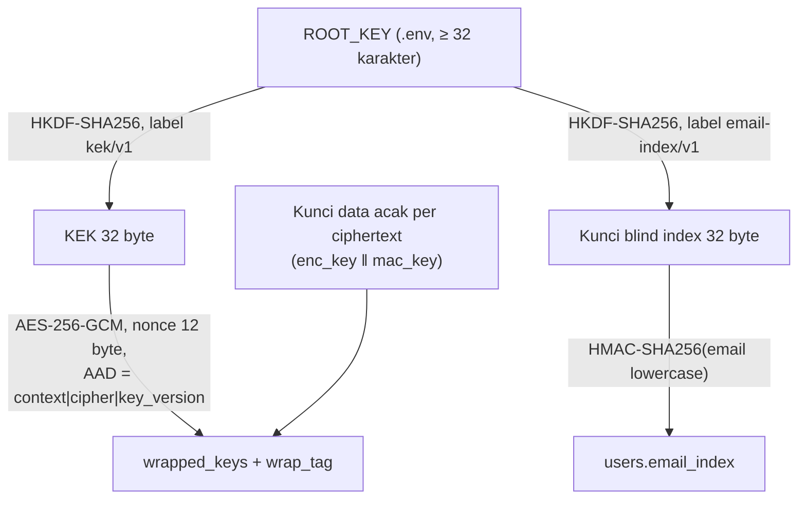

### 6.2 Parameter cipher

| Cipher | File | Kunci enkripsi | Kunci HMAC | Nonce | Integritas |
| --- | --- | --- | --- | --- | --- |
| AES-256-CTR | `aes256_ctr_hmac.py` | 32 byte | 32 byte | 12 byte acak + counter 32 bit | HMAC-SHA256 (encrypt-then-MAC) |
| DES-CTR | `des_ctr_hmac.py` | 8 byte | 32 byte | 4 byte acak + counter 32 bit | HMAC-SHA256 |
| RC4 | `rc4.py` | 16 byte | — | tidak ada | Tidak ada (hanya kuncinya yang dilindungi tag GCM) |

HMAC (`_mac.py`) mengautentikasi `len(AAD) ‖ AAD ‖ nonce ‖ ciphertext`. Panjang AAD ikut dimasukkan supaya batas AAD dan nonce tidak ambigu. Verifikasi memakai `hmac.compare_digest`.

### 6.3 File dan fungsi

| File | Isi |
| --- | --- |
| `base.py` | `EncryptedPayload(nonce, ciphertext, tag)` dan `CipherSuite(name, enc_key_len, mac_key_len, encrypt, decrypt)` + property `authenticated` |
| `registry.py` | `SUITES`, `CIPHER_NAMES = ('aes', 'des', 'rc4')`, `get_suite(name)` (lempar `UnknownCipherError`) |
| `keyring.py` | `Keyring(root_key, version)`: menurunkan KEK dan kunci indeks. `kek(version)`, `blind_index(value)` |
| `envelope.py` | `SealedCiphertext` (kolom-kolomnya sama dengan tabel `ciphertexts`), `build_aad`, `wrap_keys`, `unwrap_keys`, `seal`, `open_sealed` |
| `service.py` | `CryptoService(root_key, key_version, ciphers, primary_cipher)`: `seal(plaintext, cipher, context)`, `open(sealed, context)`, `email_index(email)` |
| `errors.py` | `CryptoError` → `IntegrityError` (HMAC/GCM gagal), `UnknownCipherError`, `KeyConfigError` |

### 6.4 Alur seal dan open

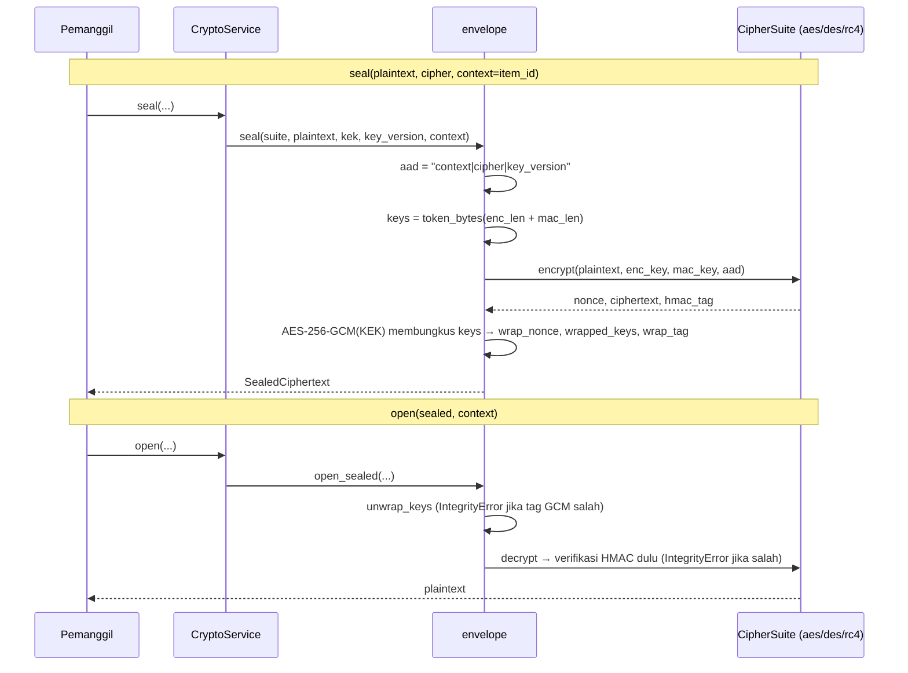

Karena `context` (ID item) masuk ke AAD, ciphertext yang dipindah ke item lain akan gagal dibuka.

### 6.5 Integrasi ke lapisan data

`crypto_services` tidak pernah dipanggil langsung dari router. Alurnya selalu lewat `app/db/items.py` → `app/db/ciphertexts.py` → `CryptoService`:

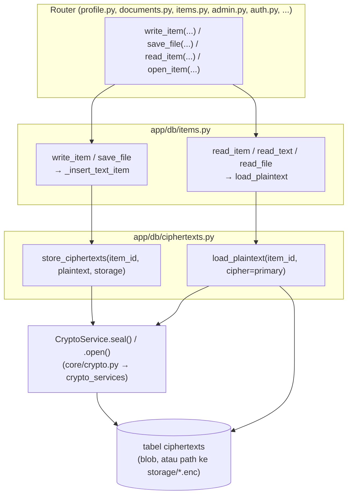

Yang penting dari integrasi ini:
- **Tulis**: setiap `write_item`/`save_file` menghasilkan **tiga baris `ciphertexts`** (satu per cipher aktif di `CRYPTO_CIPHERS`), masing-masing dengan kunci dan nonce acak sendiri.
- **Baca**: `load_plaintext` hanya mendekripsi **satu** cipher (`CRYPTO_PRIMARY_CIPHER`, default `aes`) — dua ciphertext lain tersimpan tapi tidak dibandingkan saat request biasa. Ini berbeda dari rancangan PRD yang meminta ketiganya didekripsi dan dicocokkan setiap pembukaan file (lihat [14.2](#142-selisih-dengan-prd)).
- **Tidak ada penanganan `IntegrityError` di router.** Kalau HMAC atau tag GCM gagal cocok (ciphertext/kunci rusak), `CryptoService.open()` melempar `IntegrityError` yang **tidak ditangkap** di `items.py`/`ciphertexts.py`/router mana pun — jatuh ke handler `Exception` generik di `main.py` dan dijawab **500 `internal_error`**, bukan kode khusus, dan **tidak tercatat** ke `audit_logs` meski PRD meminta kegagalan HMAC diaudit.
- **Shred = hapus kunci.** `delete_ciphertexts` menghapus baris `ciphertexts` (dan file `.enc`-nya); karena kunci pembungkusnya hilang, data lama otomatis tidak bisa dibuka lagi — tidak perlu menimpa ciphertext lama dengan nol.

---

## 7. Frontend: modul dan fungsi

### 7.1 Bootstrap dan provider

| File | Penjelasan |
| --- | --- |
| `main.tsx` | Jika `VITE_ENABLE_MSW=true`, jalankan worker MSW dulu, lalu render `<App/>` |
| `App.tsx` | `<AppProviders><AppRouter/></AppProviders>` |
| `AppProviders.tsx` | Memasang `QueryClientProvider`. Komponen `AuthSessionLifecycle` memanggil `GET /api/me` sekali saat aplikasi dibuka untuk mengisi `authStore`, lalu mendaftarkan dua listener global: **401** → hapus sesi; **403 `consent_required`** → tandai consent kedaluwarsa (guard lalu mengarahkan ke `/consent`) |
| `lib/queryClient.ts` | `staleTime` 30 detik, tidak refetch saat fokus jendela, retry query 1 kali, mutation tidak di-retry |

### 7.2 Router dan guard

`router.tsx` berisi `AppShellLayout` (header, menu per role, tombol keluar, notifikasi), halaman beranda `WorkspaceHome` (menampilkan pengaturan dari `GET /api/settings`), dan daftar route:

| Path | Guard | Halaman | Status |
| --- | --- | --- | --- |
| `/` | — | `WorkspaceHome` | Jadi |
| `/login`, `/register` | — | `LoginPage`, `RegisterPage` (`modern-login-signup.tsx`) | Jadi |
| `/consent` | Protected + Role peserta | `ConsentPage` | Jadi |
| `/dashboard` | Protected + peserta + Consent | `ParticipantDashboardPage` | Jadi |
| `/profile` | idem | `ProfilePage` | Jadi |
| `/documents` | idem | `DocumentManagerPage` | Jadi |
| `/team` | idem | `TeamWorkspacePage` | Jadi |
| `/video` | idem | `VideoUploadPage` | Jadi |
| `/encryption-inspector` | Protected + semua role + Consent | placeholder | Belum |
| `/juri/teams`, `/juri/teams/:teamId` | Protected + juri | placeholder | Belum |
| `/admin/participants`, `/admin/participants/:userId`, `/admin/teams`, `/admin/juri`, `/admin/settings`, `/admin/audit-logs` | Protected + superadmin | placeholder | Belum |
| `/admin/benchmarks` | Protected + superadmin | `BenchmarksPage` (placeholder) | Belum |
| `*` | — | redirect ke `/` | — |

| Guard (`RouteGuards.tsx`) | Perilaku |
| --- | --- |
| `ProtectedRoute` | Tampilkan "Memeriksa sesi…" selama `/api/me` belum selesai; jika tidak login → `/login` dengan `state.from` = halaman asal |
| `RoleGuard` | Jika role tidak diizinkan, tampilkan kartu "403 — Akses Ditolak" dengan tombol ke beranda role |
| `ConsentGuard` | Peserta yang belum setuju versi kebijakan aktif → `/consent` dengan `state.from` |

`pages/auth/authNavigation.ts`:
- `sanitizeReturnPath` hanya menerima path internal (diawali `/`, bukan `//`) untuk mencegah open redirect.
- `resolvePostAuthNavigation` menentukan tujuan setelah login/register: `/consent` jika perlu consent, halaman asal jika diizinkan untuk role-nya, atau beranda role.

### 7.3 Store (Zustand)

**`authStore.ts`**

| Nama | Penjelasan |
| --- | --- |
| `user`, `sessionChecked`, `isBootstrapping` | User sesi (`Me`) dan status pengecekan sesi awal |
| `needsPrivacyConsent(user)` | `true` jika peserta belum consent atau versi consent ≠ `current_policy_version` |
| `getDefaultHomeRoute(user)` | peserta → `/dashboard` (atau `/consent`), juri → `/juri/teams`, superadmin → `/admin/participants` |
| `isRouteAllowedForRole(path, role)` | Dipakai untuk memvalidasi `state.from` |
| `setSessionUser`, `clearSession`, `updateUserConsent`, `markConsentOutdated`, ... | Aksi pengubah state |

**`uiStore.ts`** — daftar `notices` (toast `info/success/warning/error`) dan `sidebarOpen`.

### 7.4 Lapisan API

| File | Penjelasan |
| --- | --- |
| `config/env.ts` | `env.apiBaseUrl`, `env.enableMsw`, `buildApiUrl(path)` |
| `api/csrf.ts` | `CSRF_COOKIE_NAME = 'csrf_access_token'`, `CSRF_HEADER_NAME = 'X-CSRF-TOKEN'`, `requiresCsrfHeader(method)` (POST/PUT/PATCH/DELETE), `getCookie`, `getCsrfToken` |
| `api/http.ts` | `fetchApi` (JSON, `credentials: 'include'`, header CSRF otomatis, parsing error); `uploadFileWithProgress` (XHR supaya ada progress; body mentah `application/octet-stream`, header `X-Filename` URL-encoded + CSRF); `fetchItemBlob` (unduh item jadi `Blob` untuk pratinjau/pemutar video); `buildQueryString`; `parseApiErrorFromBody` |
| `api/errors.ts` | `SERVER_API_ERROR_CODES` (sama dengan kode backend), kelas `ApiClientError` dengan helper seperti `isUnauthenticated()`, `isConsentRequired()` |
| `api/types.ts` | Tipe semua request/response, plus `ApiEndpointContractMap` (`'METHOD /api/path'`) yang juga dibaca test backend |
| `api/client.ts` | `apiClient.{auth, public, consent, account, profile, documents, teams, items, juri, admin}`: satu fungsi per endpoint |

### 7.5 Halaman

| Halaman | Isi | API yang dipanggil |
| --- | --- | --- |
| `modern-login-signup.tsx` (Login/Register) | Form email + password (min 10 karakter), pindah mode login/daftar, latar `three`. Setelah sukses: isi `authStore`, navigasi lewat `resolvePostAuthNavigation` | `auth.login`, `auth.register` |
| `ConsentPage` | Menampilkan teks kebijakan (markdown aman, tanpa HTML), tombol setuju, lalu kembali ke `state.from` | `public.getPolicy`, `consent.accept` |
| `ParticipantDashboardPage` | Ringkasan status verifikasi, kelengkapan profil/dokumen, tim, hitung mundur tenggat, daftar syarat final yang belum terpenuhi | `profile.get`, `documents.list`, `teams.getMine`, `public.getSettings` |
| `ProfilePage` | Form 7 field data diri dengan validasi (`profileValidation.ts`), peringatan jika field identitas diubah saat sudah terverifikasi, tanda usia < 18 | `profile.get`, `profile.update`, `public.getSettings` |
| `DocumentManagerPage` | Tiga slot KTP/KTM/twibbon: pilih file, validasi magic bytes + ukuran, upload dengan progress, pratinjau file yang sudah diunggah | `documents.list`, `documents.upload`, `items.getBlob`, `profile.get`, `public.getSettings` |
| `TeamWorkspacePage` | Buat/gabung tim, salin kode, daftar anggota + kesiapan, keluarkan anggota, keluar tim, upload proposal, set link GitHub, submit final dengan konfirmasi | `teams.create/join/getMine/leave/removeMember/uploadProposal/updateRepo/finalize` |
| `VideoUploadPage` | Ketua mengunggah MP4 (validasi + progress), lalu memutar/mengunduh video dari blob | `teams.getMine`, `teams.uploadVideo`, `items.getBlob`, `public.getSettings` |

### 7.6 Helper `lib/`

| File | Fungsi utama |
| --- | --- |
| `fileValidation.ts` | `detectMagicMimeFromBytes` (JPEG/PNG/PDF/MP4 dari byte awal), `validateDocumentFile`, `validateProposalFile`, `validateVideoFile`, `formatBytes` |
| `profileValidation.ts` | `validateProfileForm` (NIM 5–20 alfanumerik, HP `08…`/`+62…`, tanggal valid), `computeAgeFromBirthDate`, `normalizeProfileInput`, `getChangedReverifyFields` |
| `teamValidation.ts` | `validateTeamName`, `validateInviteCode` (8 alfanumerik), `validateRepoUrl` (`GITHUB_REPO_URL_REGEX`) |
| `countdown.ts` | `computeCountdown`, `formatDeadlineDisplay`, `useLiveNow` |

### 7.7 Mock (MSW)

`mocks/handlers.ts` meniru seluruh API secara stateful (user, tim, dokumen di memori) memakai helper validasi yang sama dengan halaman. Dipakai oleh `npm run dev:mock`, test Vitest (`mocks/server.ts`), dan E2E Playwright.

---

## 8. Model data dan ERD

Skema aktif = `migrations/001_initial.sql` + `002_api_contract.sql` (`PRAGMA user_version = 2`) — skema kripto. Skema plaintext lama (`migrations_before_crypto/`) masih ada di repo sebagai arsip, tidak dijalankan lagi (`database.py` menolak membuka database berskema plaintext lewat `_reject_plaintext_database`). Semua ID berupa UUID teks, semua waktu berupa teks ISO 8601 UTC (`strftime('%Y-%m-%dT%H:%M:%fZ')`).

### 8.1 ERD (skema aktif)

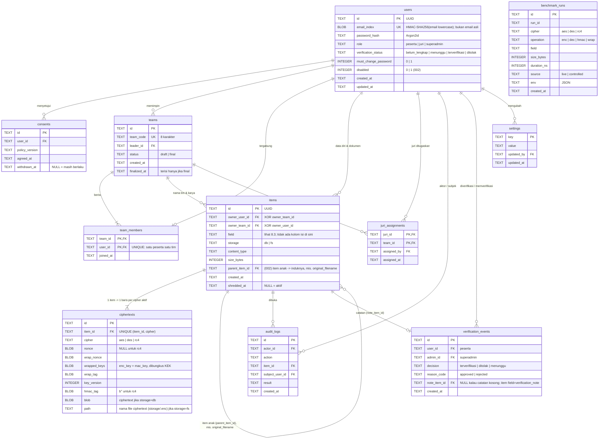

`benchmark_runs` berdiri sendiri (tanpa foreign key).

### 8.2 Penjelasan tabel

| Tabel | Isi | Batasan penting |
| --- | --- | --- |
| `users` | Akun semua peran. **Tidak ada kolom email** — email asli tersimpan sebagai item `field='email'` milik user, terenkripsi seperti field lain | `email_index` unik; `role`, `verification_status`, `must_change_password`, `disabled` dibatasi `CHECK` |
| `consents` | Bukti persetujuan kebijakan per versi | `UNIQUE (user_id, policy_version)`; hapus user → ikut terhapus |
| `teams` | Tim | `team_code` unik; `leader_id` `ON DELETE RESTRICT`; `CHECK` `finalized_at` terisi ⇔ `status = 'final'` |
| `team_members` | Relasi tim–anggota (ketua juga anggota) | `user_id` unik → satu peserta satu tim; hapus tim → anggota ikut terhapus |
| `items` | **Hanya metadata** data isian (pemilik, field, tipe, ukuran) — isinya sendiri ada di `ciphertexts`, tidak pernah di tabel ini | Tepat satu pemilik (`owner_user_id` XOR `owner_team_id`); index unik parsial `uq_active_user_item`/`uq_active_team_item` (hanya item **induk**, `parent_item_id IS NULL`) dan `uq_active_child_item` (per `parent_item_id`+field) → **maksimal satu item aktif per (pemilik, field)**, dan satu per (induk, field anak) |
| `ciphertexts` | Isi terenkripsi tiap item, satu baris per cipher aktif | `UNIQUE (item_id, cipher)`; `blob` XOR `path`; `nonce` wajib untuk aes/des, `NULL` untuk rc4; hapus item → ikut terhapus (`ON DELETE CASCADE`) |
| `juri_assignments` | Tim yang boleh dibuka seorang juri | PK `(juri_id, team_id)`; superadmin pemberi tugas tidak bisa dihapus (`RESTRICT`) |
| `audit_logs` | Jejak akses dan aksi | Tanpa isi data pribadi; hapus user/item → referensi jadi `NULL`; index `(actor_id, created_at)` dan `(subject_user_id, created_at)` |
| `settings` | Pengaturan key-value | `key` primary key |
| `verification_events` | Riwayat keputusan verifikasi. Catatan admin **tidak** disimpan langsung di tabel ini, hanya `reason_code` (`approved`/`rejected`) + pointer `note_item_id` ke item terenkripsi | Hapus peserta → ikut terhapus; admin `RESTRICT`; `note_item_id` → `NULL` kalau item-nya ikut terhapus |
| `benchmark_runs` | Hasil pengukuran cipher (diisi tim benchmark) | Index `(cipher, operation, size_bytes)` |

### 8.3 Nilai `items.field`

| Pemilik | `field` | `storage` | Ditulis oleh |
| --- | --- | --- | --- |
| User | `email` | `db` | `create_user` (saat register / dibuat admin) |
| User | `full_name`, `nim`, `study_program`, `institution`, `birth_date`, `domicile`, `phone` | `db` | `PUT /api/profile` |
| User | `ktp`, `ktm`, `twibbon` | `fs` | `POST /api/documents/{type}` |
| User | `verification_note` | `db` | `PATCH /api/admin/participants/{id}` (dikosongkan lagi lewat `shred_field` jika `note` dikirim kosong) |
| Tim | `team_name` | `db` | `POST /api/teams` |
| Tim | `repo_url` | `db` | `PUT /api/teams/me/repo` |
| Tim | `proposal`, `video` | `fs` | `POST /api/teams/me/proposal`, `/video` |
| Item file (anak, `parent_item_id` terisi) | `original_filename` | `db` | Otomatis tiap kali `save_file` dipanggil (ktp/ktm/twibbon/proposal/video) |

**Pola "shred lalu insert".** Field yang ditulis ulang tidak di-`UPDATE`. Item lama (dan item anaknya, kalau ada) ditandai `shredded_at`, baris `ciphertexts`-nya (dan file `.enc`-nya) dihapus permanen, lalu baris `items`+`ciphertexts` baru dibuat dengan kunci dan nonce baru. Karena kuncinya ikut dibuang, item lama **tidak bisa didekripsi lagi** meski baris `items`-nya sendiri masih ada (`shredded_at` terisi) — ini yang membuat pola shred benar-benar menghapus, bukan sekadar soft-delete.

### 8.4 Isi tabel `settings`

| Key | Default | Dipakai di |
| --- | --- | --- |
| `registration_deadline` | kosong (fallback ke `deadline_at`) | Upload dokumen, buat tim, gabung tim |
| `submission_deadline` | kosong (fallback ke `deadline_at`) | Upload proposal/video, set repo, submit final |
| `min_team_size` | `2` | `finalize_missing` → `min_members` |
| `max_team_size` | `4` (fallback ke `max_team_members`) | Gabung tim, submit final |
| `privacy_policy_version` | `v1` | `require_consent`, `POST /api/consent`, `me_data` |
| `privacy_policy_text` | teks singkat | `GET /api/policy` |

### 8.5 Aksi yang dicatat di `audit_logs`

| `action` | Kapan | `subject_user_id` |
| --- | --- | --- |
| `open_item:<field>` | Siapa pun membuka item yang bukan miliknya/timnya (superadmin atau juri), mis. `open_item:ktp`, `open_item:video` | Pemilik item (NULL untuk item tim) |
| `view_profile` | Superadmin melihat daftar/detail peserta; juri membuka detail tim (per anggota) | Peserta yang dilihat |
| `verify_participant` | Superadmin menerima/menolak (`result` = keputusan) | Peserta |
| `create_juri` | Superadmin membuat akun juri | Juri baru |
| `assign_juri` | Superadmin mengubah penugasan juri | Juri |
| `update_settings` | Superadmin mengubah pengaturan | — |
| `remove_team_member` | Ketua mengeluarkan anggota | Anggota yang dikeluarkan |

Peserta bisa melihat semua log yang menyangkut dirinya lewat `GET /api/me/access-log`. **Tidak ada** aksi untuk kegagalan HMAC/integritas (`IntegrityError`) — lihat catatan di [6.5](#65-integrasi-ke-lapisan-data) dan [14.2](#142-selisih-dengan-prd).

---

## 9. Keamanan dan hak akses

### 9.1 Sesi dan CSRF

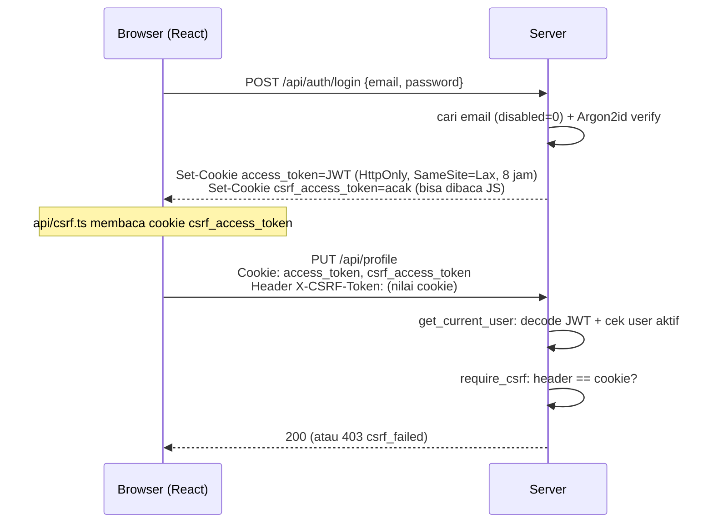

- **Kenapa aman dari CSRF:** situs lain bisa membuat browser mengirim cookie, tapi tidak bisa membaca nilai `csrf_access_token` untuk diisi ke header.
- **JWT tidak bisa dicuri lewat XSS** karena `access_token` HttpOnly.
- **Batasan JWT stateless:** logout hanya menghapus cookie; token yang sudah terbit tetap sah sampai 8 jam, kecuali akunnya di-`disabled`.
- **Role dibaca dari database** di setiap request, bukan dari isi JWT.

### 9.2 Lapisan pengecekan

| Pengecekan | Fungsi | Gagal |
| --- | --- | --- |
| Sudah login dan akun aktif | `get_current_user` | 401 `unauthenticated` |
| Role sesuai | `require_roles(...)` | 403 `forbidden` |
| Token CSRF (semua request yang mengubah data) | `require_csrf` | 403 `csrf_failed` |
| Persetujuan privasi (profil, dokumen) | `require_consent` | 403 `consent_required` |
| Ketua tim, tim belum final | `_get_editable_team` | 403 `not_leader` / 409 `team_locked` |
| Tenggat | `is_past_deadline` | 409 `deadline_passed` |
| Hak membuka item | logika di `open_item` | 404 `not_found` |
| Brute force login dan kode tim | `@limiter.limit("10/minute")` | 429 `rate_limited` |
| Password | Argon2id, 10–128 karakter | 400 `validation_error` |

### 9.3 Matriks akses endpoint

| Endpoint | Publik | Peserta | Juri | Superadmin |
| --- | --- | --- | --- | --- |
| `POST /auth/register`, `POST /auth/login`, `GET /policy`, `GET /settings`, `GET /health` | ✅ | ✅ | ✅ | ✅ |
| `GET /me`, `POST /auth/logout`, `PUT /auth/password` | — | ✅ | ✅ | ✅ |
| `POST /consent`, `DELETE /consent`, `GET /me/items`, `GET /me/access-log`, `GET /me/export` | — | ✅ | ❌ | ❌ |
| `GET /profile`, `GET /documents` | — | ✅ | ❌ | ❌ |
| `PUT /profile`, `POST /documents/{type}` | — | ✅ + consent | ❌ | ❌ |
| `POST /teams`, `POST /teams/join`, `POST /teams/me/leave` | — | ✅ | ❌ | ❌ |
| `GET /teams/me` | — | ✅ | `{team: null}` | `{team: null}` |
| `DELETE /teams/me/members/{id}`, `POST /teams/me/proposal`, `/video`, `PUT /teams/me/repo`, `POST /teams/me/finalize` | — | ketua saja | ❌ | ❌ |
| `GET /items/{id}` | — | lihat 9.4 | lihat 9.4 | lihat 9.4 |
| `/juri/*` | — | ❌ | ✅ | ❌ |
| `/admin/*` | — | ❌ | ❌ | ✅ |

### 9.4 Matriks akses `GET /api/items/{id}`

| Pengakses | Item pribadi (data diri, KTP/KTM/twibbon) | Item tim (nama tim, proposal, video, repo) |
| --- | --- | --- |
| Pemilik | ✅ | — |
| Anggota tim yang sama | ❌ 404 | ✅ |
| Juri | ❌ 404 | ✅ proposal/video/repo_url, **hanya jika tim final dan ditugaskan ke juri itu**, tercatat |
| Superadmin | ✅ tercatat | ✅ tercatat |
| Lainnya | ❌ 404 | ❌ 404 |

Item yang tidak boleh dibuka dijawab **404**, sama seperti item yang tidak ada, supaya keberadaan ID tidak bisa ditebak. Response item selalu membawa `Cache-Control: no-store` dan `X-Content-Type-Options: nosniff`.

---

## 10. Alur aplikasi

### 10.1 Status verifikasi peserta

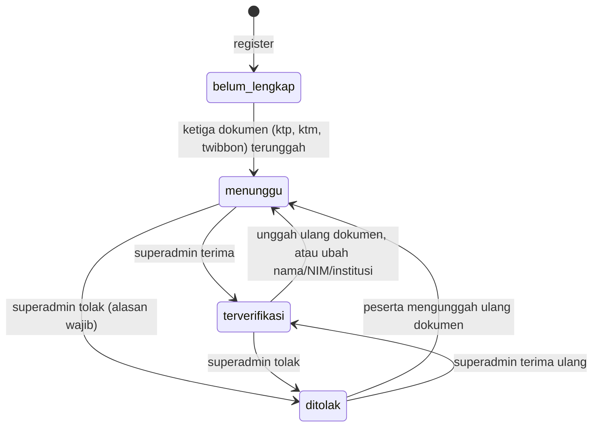

Superadmin tidak bisa memverifikasi peserta yang masih `belum_lengkap` (409).

### 10.2 Status tim

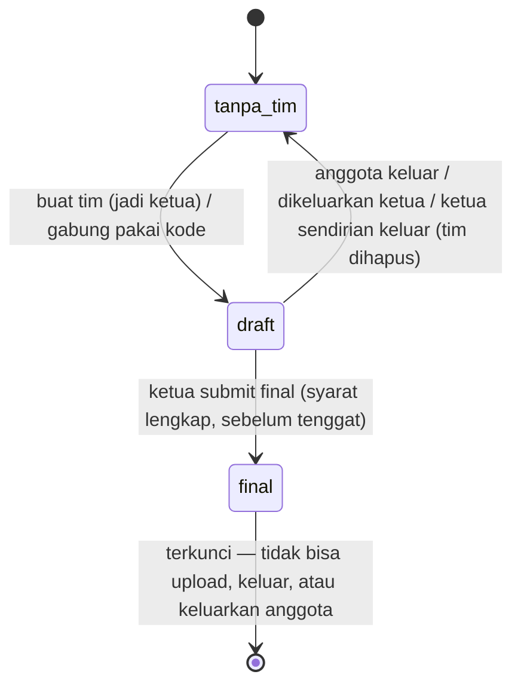

Status verifikasi peserta dan status tim berjalan terpisah: tim boleh submit final sebelum superadmin selesai memverifikasi anggotanya.

### 10.3 Membuka aplikasi dan login (frontend)

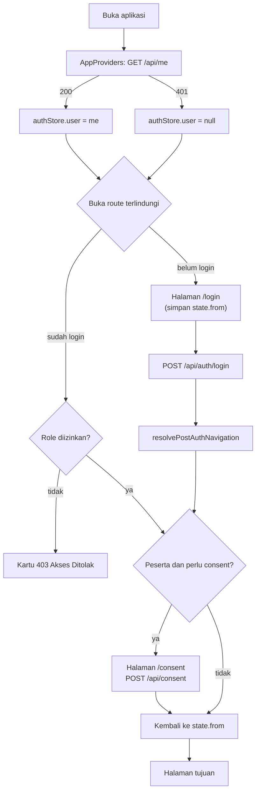

Selama memakai aplikasi, respons **401** dari endpoint mana pun mengosongkan sesi (pengguna diarahkan ke login), dan respons **403 `consent_required`** (misalnya superadmin menaikkan versi kebijakan) mengarahkan peserta kembali ke `/consent`.

### 10.4 Alur lengkap peserta

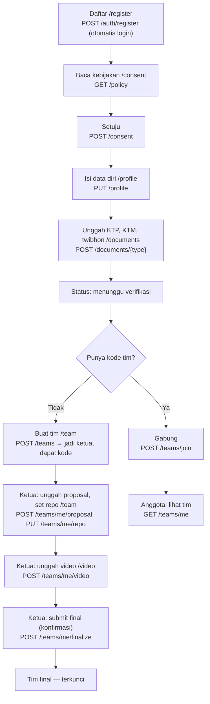

Kapan saja peserta bisa: membuka file sendiri (`GET /items/{id}`), melihat siapa yang membuka datanya (`GET /me/access-log`), mengunduh semua datanya (`GET /me/export`), atau menarik persetujuan (`DELETE /consent`).

### 10.5 Upload dokumen

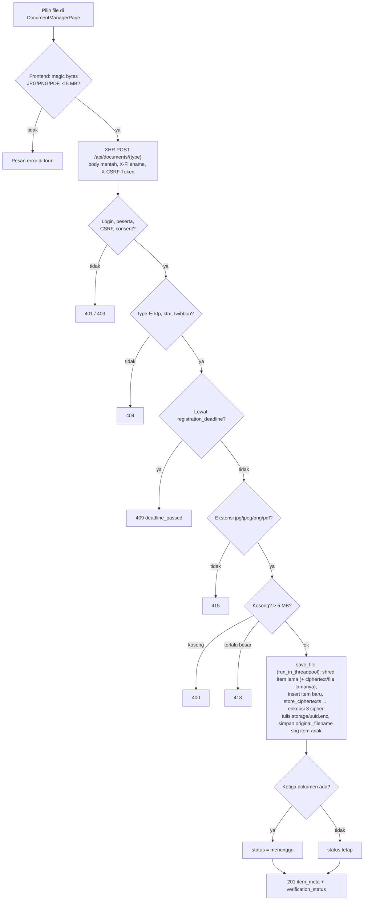

Upload proposal dan video mengikuti pola yang sama lewat `_get_editable_team` (ketua, belum final, sebelum `submission_deadline`), dengan tipe PDF maks 10 MB dan MP4 maks 100 MB. `save_file` dijalankan lewat `run_in_threadpool` karena mengenkripsi dengan 3 cipher adalah kerja CPU-bound yang bisa memblokir event loop `asyncio` kalau dijalankan langsung di handler `async def`.

### 10.6 Membentuk tim

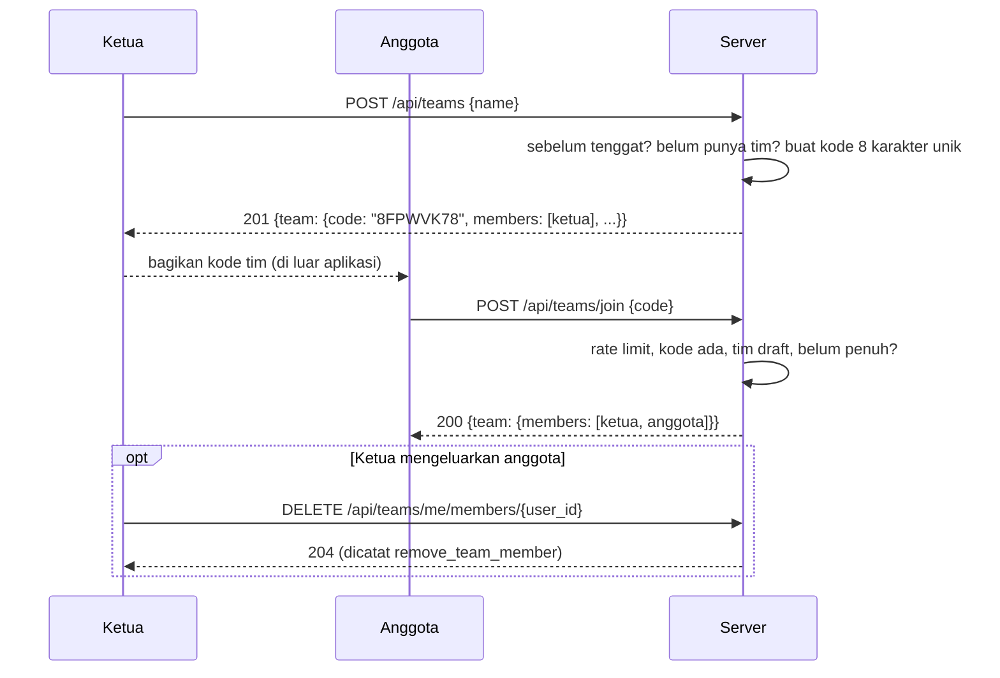

### 10.7 Submit final

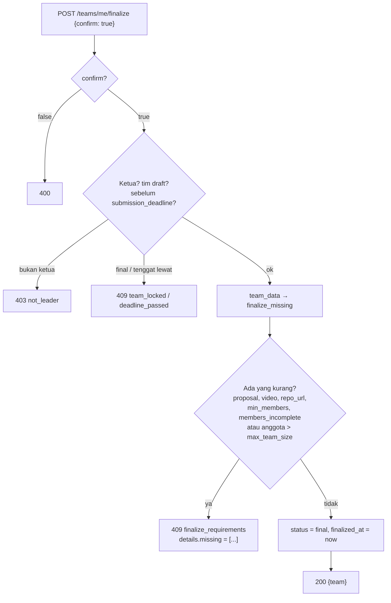

`members_incomplete` berarti ada anggota yang belum mengisi ketujuh field data diri atau belum mengunggah ketiga dokumen. Frontend menampilkan daftar ini sebelum tombol submit aktif.

### 10.8 Membuka item

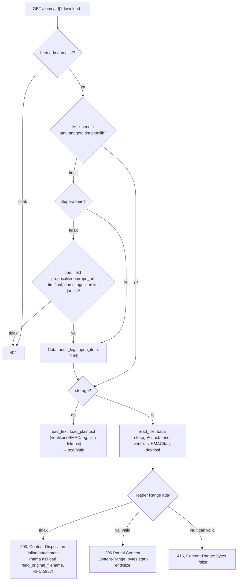

- **Dekripsi selalu pakai satu cipher** (`CRYPTO_PRIMARY_CIPHER`, default `aes`) lewat `load_plaintext`/`_pick_row` — bukan ketiga cipher sekaligus dibandingkan seperti yang diminta PRD.
- **Kalau HMAC/tag gagal** (ciphertext rusak atau salah konteks), `IntegrityError` tidak ditangkap di `open_item` — jatuh ke 500 `internal_error` generik, bukan kode khusus, dan tidak tercatat di audit log (lihat [6.5](#65-integrasi-ke-lapisan-data)).
- **`Range` request** (dukungan baru) memungkinkan video diputar/di-seek tanpa mengunduh seluruh file dulu — tapi file tetap didekripsi penuh ke memori sebelum dipotong sesuai range, jadi tidak menghemat waktu dekripsi/CPU, hanya menghemat bandwidth ke browser.

Di frontend, `fetchItemBlob` mengunduh file utuh menjadi `Blob`, lalu halaman membuat object URL untuk pratinjau gambar/PDF atau memutar video.

### 10.9 Alur superadmin

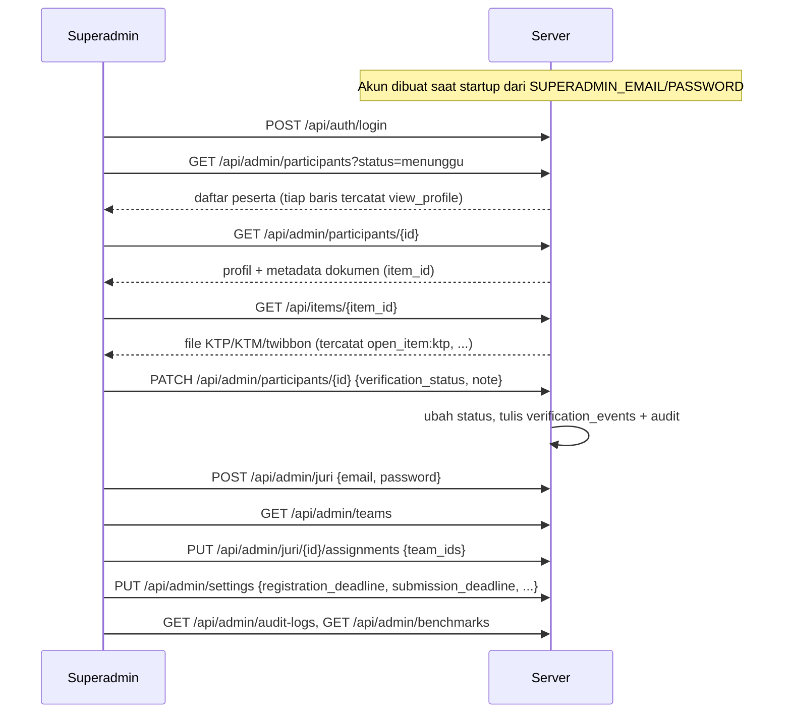

### 10.10 Tarik persetujuan

`DELETE /api/consent` (peserta) menjalankan langkah berikut dalam satu transaksi:

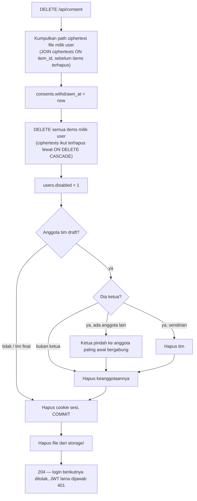

### 10.11 Alur juri

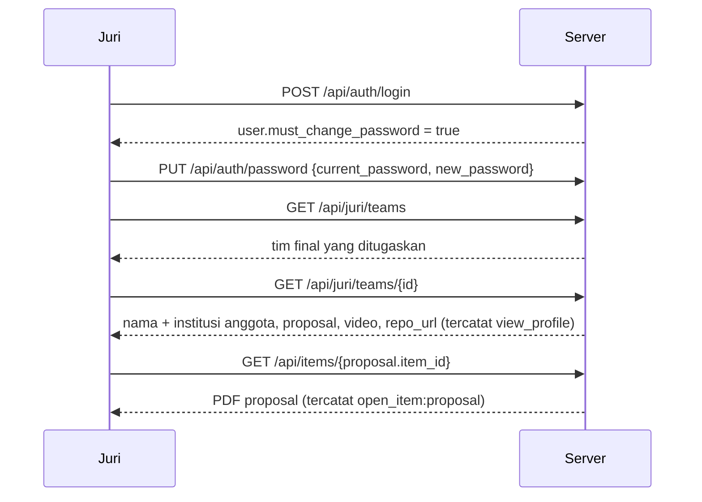

---

## 11. Daftar endpoint

Semua path berprefix `/api` kecuali `/health`. "CSRF" = wajib header `X-CSRF-Token`. Upload memakai body mentah (`application/octet-stream`) dengan header `X-Filename` berisi nama file yang di-URL-encode.

### Auth

| Method | Path | Akses | Body | Response |
| --- | --- | --- | --- | --- |
| POST | `/auth/register` | publik | `{email, password}` | 201 `{user}` + cookie sesi |
| POST | `/auth/login` | publik, 10/menit | `{email, password}` | 200 `{user}` + cookie sesi |
| PUT | `/auth/password` | login + CSRF | `{current_password, new_password}` | 204 |
| POST | `/auth/logout` | login + CSRF | — | 204 |

### Akun dan privasi

| Method | Path | Akses | Body / query | Response |
| --- | --- | --- | --- | --- |
| GET | `/me` | login | — | `me_data` |
| GET | `/settings` | publik | — | `public_settings` |
| GET | `/policy` | publik | — | `{version, text_markdown}` |
| POST | `/consent` | peserta + CSRF | `{policy_version}` | 201 `{policy_version, agreed_at}` |
| DELETE | `/consent` | peserta + CSRF | — | 204 |
| GET | `/me/items` | peserta | — | `{items: [item_meta]}` |
| GET | `/me/access-log` | peserta | `page`, `page_size` | `{items, page, page_size, total}` |
| GET | `/me/export` | peserta | — | ZIP |

### Profil dan dokumen

| Method | Path | Akses | Body | Response |
| --- | --- | --- | --- | --- |
| GET | `/profile` | peserta | — | `profile_data` |
| PUT | `/profile` | peserta + CSRF + consent | subset 7 field | `profile_data` |
| GET | `/documents` | peserta | — | `documents_data` |
| POST | `/documents/{ktp\|ktm\|twibbon}` | peserta + CSRF + consent | file ≤ 5 MB | 201 `item_meta` + `verification_status` |

### Tim dan karya

| Method | Path | Akses | Body | Response |
| --- | --- | --- | --- | --- |
| POST | `/teams` | peserta + CSRF | `{name}` | 201 `{team}` |
| POST | `/teams/join` | peserta + CSRF, 10/menit | `{code}` | 200 `{team}` |
| GET | `/teams/me` | login | — | `{team}` atau `{team: null}` |
| POST | `/teams/me/leave` | peserta + CSRF | — | 204 |
| DELETE | `/teams/me/members/{user_id}` | ketua + CSRF | — | 204 |
| POST | `/teams/me/proposal` | ketua + CSRF | PDF ≤ 10 MB | 201 `item_meta` |
| POST | `/teams/me/video` | ketua + CSRF | MP4 ≤ 100 MB | 201 `item_meta` |
| PUT | `/teams/me/repo` | ketua + CSRF | `{repo_url}` | `{repo_url}` |
| POST | `/teams/me/finalize` | ketua + CSRF | `{confirm: true}` | `{team}` |
| GET | `/items/{item_id}` | sesuai 9.4 | `download` (opsional) | file / teks |

### Juri

| Method | Path | Response |
| --- | --- | --- |
| GET | `/juri/teams` | `{teams: [{id, name, finalized_at, member_count}]}` |
| GET | `/juri/teams/{team_id}` | `{team: {id, name, finalized_at, members[], proposal, video, repo_url}}` |

### Superadmin

| Method | Path | Body / query | Response |
| --- | --- | --- | --- |
| GET | `/admin/participants` | `page`, `page_size`, `status` | `{items, page, page_size, total}` |
| GET | `/admin/participants/{user_id}` | — | detail peserta |
| PATCH | `/admin/participants/{user_id}` | `{verification_status, note}` | `{user_id, verification_status, verification_note}` |
| GET | `/admin/teams` | `page`, `page_size` | `{items, page, page_size, total}` |
| GET | `/admin/juri` | — | `{juri: [{user_id, email, created_at}]}` |
| POST | `/admin/juri` | `{email, password}` | 201 `{user_id, email, role}` |
| PUT | `/admin/juri/{juri_id}/assignments` | `{team_ids: [...]}` | `{juri_id, team_ids}` |
| GET | `/admin/settings` | — | `public_settings` + versi & teks kebijakan |
| PUT | `/admin/settings` | `registration_deadline`, `submission_deadline`, `min_team_size`, `max_team_size`, `privacy_policy_version`, `privacy_policy_text` | `public_settings` |
| GET | `/admin/audit-logs` | `page`, `page_size`, `actor_id`, `action`, `from`, `to` | `{items, page, page_size, total}` |
| GET | `/admin/benchmarks` | `source`, `operation` | `{env, rows: [{cipher, operation, size_bytes, n, median_ns, q1_ns, q3_ns, median_mb_s}]}` |

### Lain-lain

| Method | Path | Response |
| --- | --- | --- |
| GET | `/health` | `{"status": "ok"}` |

Dokumentasi interaktif otomatis dari FastAPI ada di `http://127.0.0.1:8000/docs`.

---

## 12. Format error dan kode status

Semua error memakai format yang sama:

```json
{
  "error": {
    "code": "finalize_requirements",
    "message": "Syarat submit final belum lengkap",
    "details": { "missing": ["video", "members_incomplete"] }
  }
}
```

`details` hanya ada di sebagian error (validasi → `details.fields`, submit final → `details.missing`).

| Status | `code` yang mungkin | Contoh penyebab |
| --- | --- | --- |
| 400 | `validation_error` | Body tidak valid (termasuk error Pydantic), file kosong, `confirm: false`, min > max ukuran tim |
| 401 | `unauthenticated`, `invalid_credentials` | Belum login, sesi kedaluwarsa, akun dinonaktifkan, email/password salah |
| 403 | `forbidden`, `csrf_failed`, `consent_required`, `not_leader` | Role salah, CSRF salah, belum setuju privasi, bukan ketua |
| 404 | `not_found` | Tidak ada, atau tidak berhak membuka |
| 409 | `conflict`, `email_taken`, `already_in_team`, `team_full`, `team_locked`, `deadline_passed`, `policy_outdated`, `finalize_requirements` | Konflik aturan bisnis |
| 413 | `too_large` | File melebihi batas |
| 415 | `unsupported_type` | Ekstensi tidak didukung |
| 429 | `rate_limited` | Lebih dari 10 percobaan/menit (login, gabung tim) |
| 500 | `internal_error` | Error tak terduga |

Di frontend, error ini menjadi `ApiClientError` (`api/errors.ts`) dengan `status`, `code`, `message`, `details`.

---

## 13. Menjalankan dan menguji

### 13.1 Backend

```bash
cd backend
python -m venv .venv && source .venv/bin/activate
pip install -r requirements-dev.txt
cp .env.example .env     # isi JWT_SECRET_KEY, SUPERADMIN_EMAIL, SUPERADMIN_PASSWORD
python run.py            # http://127.0.0.1:8000, dokumentasi di /docs
```

Untuk mulai dari database kosong: hentikan server, hapus `backend/data/schematics.db*` dan isi `backend/storage/`, lalu jalankan lagi.

### 13.2 Frontend

```bash
cd frontend
npm install
cp .env.example .env
# ubah VITE_API_PROXY_TARGET menjadi http://127.0.0.1:8000
npm run dev              # http://127.0.0.1:5173 (proxy /api ke backend)
npm run dev:mock         # tanpa backend, pakai MSW
```

### 13.3 Pengujian

| Perintah | Isi |
| --- | --- |
| `cd backend && pytest` | 6 test di `tests/test_api_contract.py`: (1) semua endpoint di `types.ts` dan `client.ts` frontend ada di backend; (2) alur peserta lengkap + akses juri yang ditugaskan; (3) format error dan CSRF; (4) pengaturan admin, verifikasi, ekspor data, tarik persetujuan; (5) migration 001 → 002 tanpa kehilangan data; (6) ringkasan benchmark dan filter audit log |
| `cd frontend && npm test` | Vitest: unit test API client, kontrak, guard/alur auth, dan tiap halaman peserta (dengan MSW) |
| `cd frontend && npm run test:e2e` | Playwright: smoke + route guard, alur auth/consent, profil/dokumen |
| `cd frontend && npm run lint` / `npm run typecheck` | oxlint / `tsc -b` |

### 13.4 Mencoba dengan `curl`

```bash
B=http://127.0.0.1:8000/api
curl -c c.txt -X POST $B/auth/register -H 'Content-Type: application/json' \
     -d '{"email":"a@x.com","password":"Password123"}'
CSRF=$(grep csrf_access_token c.txt | awk '{print $7}')
curl -b c.txt -X POST $B/consent -H 'Content-Type: application/json' -H "X-CSRF-Token: $CSRF" \
     -d '{"policy_version":"v1"}'
curl -b c.txt -X PUT $B/profile -H 'Content-Type: application/json' -H "X-CSRF-Token: $CSRF" \
     -d '{"full_name":"Budi"}'
curl -b c.txt -X POST $B/documents/ktp -H "X-CSRF-Token: $CSRF" -H 'X-Filename: ktp.jpg' \
     --data-binary @ktp.jpg
```

---

## 14. Status, batasan, dan catatan

### 14.1 Isu yang ditemukan

| Isu | Keadaan | Pemilik |
| --- | --- | --- |
| **Test `test_existing_database_migrates_without_data_loss` gagal** | `sqlite3.OperationalError: table users has no column named email`. Test ini masih memakai skema plaintext lama (`INSERT INTO users (..., email, ...)`, `INSERT INTO items (..., value) ...`) padahal `MIGRATIONS` sekarang mengarah ke skema kripto yang tidak punya kolom itu. Test ini **tidak ikut diperbarui** oleh commit `1d78bcf`. Hasil `pytest` saat ini: **5 passed, 1 failed** | Tim kripto / siapa pun yang menyentuh `tests/test_api_contract.py` |
| Kegagalan HMAC/integritas tidak tertangani | `CryptoService.open()` melempar `IntegrityError` saat tag HMAC/GCM tidak cocok, tapi **tidak ada router atau lapisan data yang menangkapnya**. Efeknya: 500 `internal_error` generik (bukan kode `integrity_error` yang sudah didaftarkan di frontend `api/errors.ts`), dan **tidak tercatat** ke `audit_logs` — padahal PRD (bagian Audit) secara eksplisit meminta kegagalan HMAC diaudit | Tim kripto / backend |
| Pencatatan `benchmark_runs` dan dashboard benchmark | Tabel dan endpoint ringkasan sudah ada (`GET /admin/benchmarks`), isinya masih kosong — tidak ada kode yang menulis ke `benchmark_runs` saat enkripsi/dekripsi berjalan | Tim benchmark |
| Halaman juri, superadmin, Encryption Inspector | Masih `RoutePlaceholder`; `apiClient.juri.*` dan `apiClient.admin.*` sudah tersedia. Halaman-halaman ini belum menampilkan apa pun soal enkripsi yang kini aktif di backend | Tim frontend |

### 14.2 Selisih dengan PRD

- **Pembukaan file hanya 1 cipher, bukan 3 dibandingkan.** PRD meminta ketiga cipher didekripsi penuh dan dicocokkan sebelum data dikirim (supaya ketiganya dijamin konsisten). Implementasi saat ini (`load_plaintext` / `_pick_row`) hanya mendekripsi **satu** cipher (`CRYPTO_PRIMARY_CIPHER`, default `aes`); dua ciphertext lain tersimpan tapi tidak pernah dibaca saat pembukaan normal.
- **Parameter AES:** PRD menyebut nonce 8 byte + counter 8 byte; `aes256_ctr_hmac.py` memakai nonce 12 byte + counter 32 bit.
- **RC4:** PRD meminta 3072 byte awal keystream dibuang (`drop=3072`) dan HMAC per file; `rc4.py` memakai `ARC4.new(k)` tanpa drop dan tanpa HMAC.
- **Audit kegagalan integritas:** PRD meminta kegagalan HMAC dicatat di audit log; lihat 14.1 — belum ada.
- **Akses juri:** PRD menyebut "semua tim final", implementasi membatasi ke tim yang ditugaskan lewat `juri_assignments` (sesuai tabel model data PRD).
- **Tipe file** di backend dicek dari ekstensi nama file, bukan magic bytes. Magic bytes baru dicek di frontend (`lib/fileValidation.ts`), jadi bisa dilewati dengan memanggil API langsung.
- **Upload** dibaca utuh ke memori (`request.body()`), bukan per chunk 1 MB dari `request.stream()`. Video 100 MB memakan memori sebesar itu — kini ditambah tiga kali lipat karena dienkripsi 3 cipher sebelum ditulis ke disk (`store_ciphertexts`), meski penulisan file per cipher di-threadpool-kan agar tidak memblokir event loop.

### 14.3 Batasan yang disadari

- **`ROOT_KEY` kini wajib dan tidak boleh berubah.** Server gagal start kalau `ROOT_KEY` kosong/< 32 karakter. Mengganti `ROOT_KEY` setelah ada data membuat **semua data lama tidak bisa dibuka lagi** (KEK berubah, `wrapped_keys` lama tidak bisa dibongkar). Database dari skema plaintext lama juga ditolak total (`_reject_plaintext_database`) — tidak ada jalur migrasi/konversi otomatis dari data plaintext ke terenkripsi.
- Logout tidak membatalkan JWT yang sudah terbit (sesi stateless, berlaku 8 jam).
- Rate limit hanya per IP dan disimpan di memori (hilang saat server restart).
- Tenggat tanpa zona waktu dianggap jam lokal server.
- `PUT /profile` tidak dicek terhadap tenggat di backend.
- `GET /admin/participants` mencatat `view_profile` untuk setiap peserta yang tampil di halaman daftar, sehingga audit log cepat bertambah.
- Setiap pembacaan field teks (`read_item`, `me_data`, `profile_data`, dst.) dan setiap tampilan daftar (peserta, tim, audit log) sekarang melakukan dekripsi (`load_plaintext` → `CryptoService.open`) per field per baris — belum ada pengukuran berapa besar dampaknya ke latensi endpoint daftar (`GET /admin/participants`, `GET /admin/audit-logs`) dibanding versi plaintext.

### 14.4 Catatan untuk tim

- **Port proxy frontend:** `frontend/.env.example` dan `vite.config.ts` default ke `http://127.0.0.1:5000` (sisa rencana Flask), sedangkan backend FastAPI jalan di `8000`. Isi `VITE_API_PROXY_TARGET=http://127.0.0.1:8000`.
- **Dokumen lama:** `backend/API.md` masih memakai path lama (`/auth/me`, `/privacy/notice`, `/profile/me`, `?filename=`, `/judges/*`, format `{"detail": ...}`). Pakai dokumen ini atau `/docs` sebagai acuan. (`backend/ARCHITECTURE.md` — versi lama dari dokumen ini — sudah dihapus dan digabung ke sini.)
- **Query key tim di frontend tidak seragam:** `TeamWorkspacePage` memakai `['team', 'me']`, sedangkan `ParticipantDashboardPage` dan `DocumentManagerPage` memakai `['teams', 'me']` (`VideoUploadPage` memakai keduanya). Setelah aksi tim, data di halaman lain bisa tertinggal sampai `staleTime` 30 detik habis.
